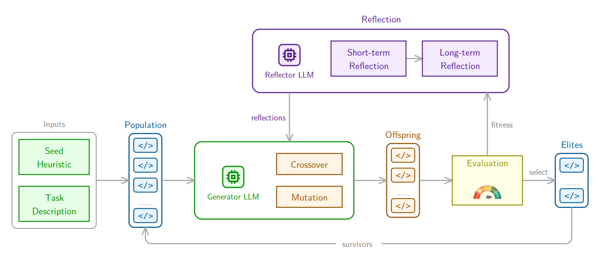
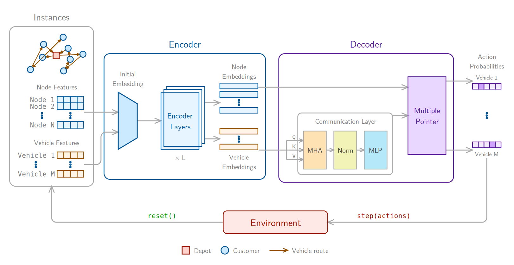
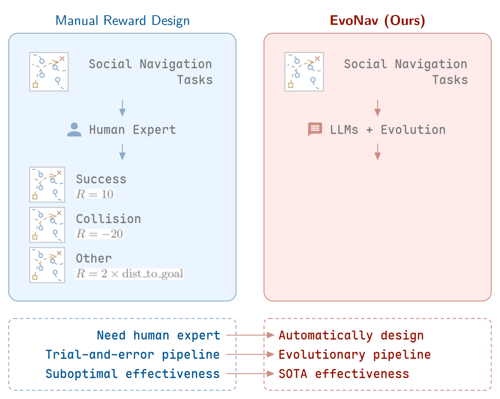
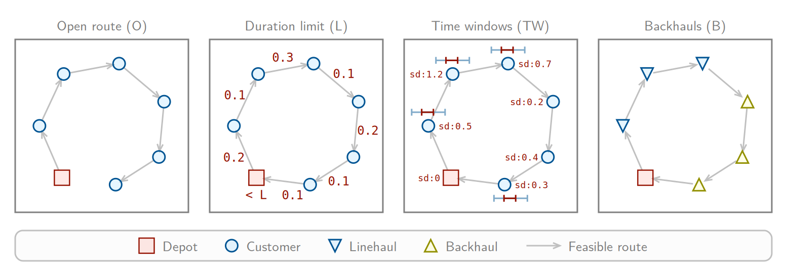
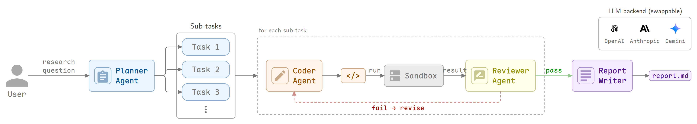
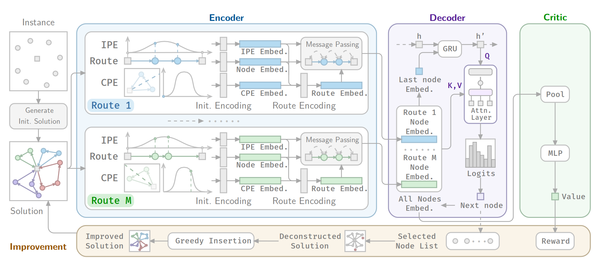
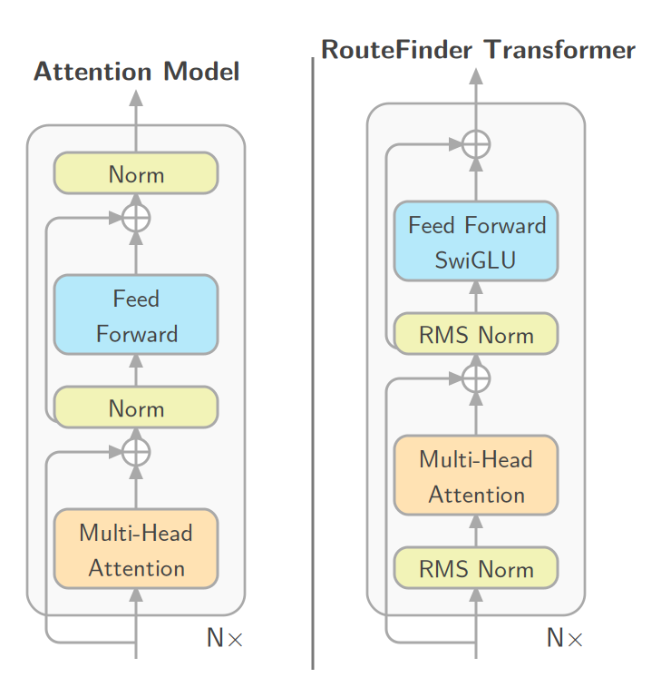
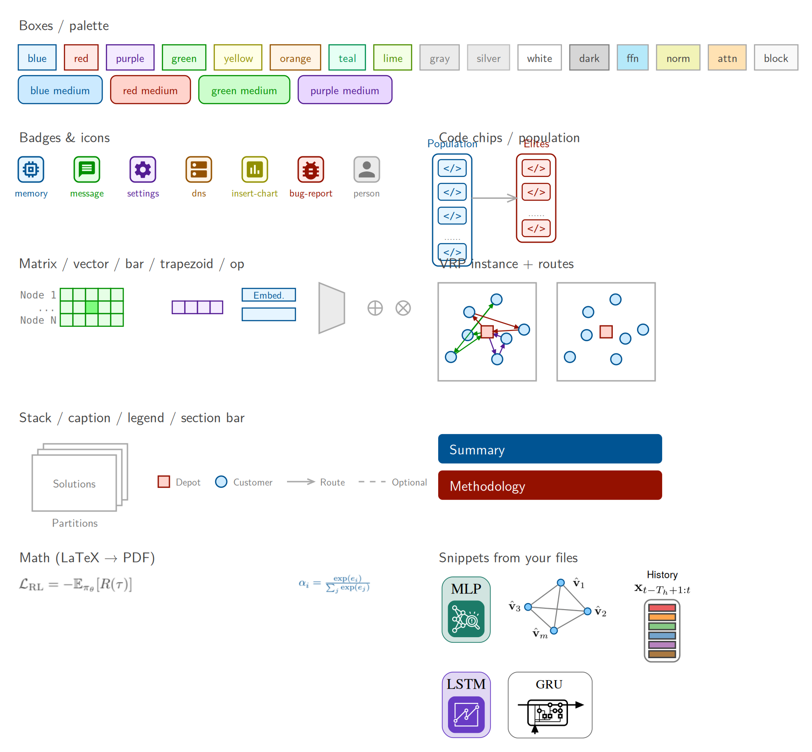

# omnigraffle-skills

用 Agent / AI 直接生成 **可在 OmniGraffle 中继续编辑** 的插图，风格、配色、字体、素材全部来自你过去 120 个 `.graffle` 源文件。

```
你："画一张 LLM 进化启发式的方法总览图"
        │  Claude Code + skill (.claude/skills/omnigraffle-figure)
        ▼
figures/<name>/make.py  ──ogkit──▶  <name>.graffle  (原生形状 / 绑定连线 / 可改色图标 / LaTeX 矢量公式)
                                  └▶ <name>.png      (Linux 预览，Agent 用它自检迭代)
        │
        ▼  在 Mac 上用 OmniGraffle 打开，直接微调
```

## 里面有什么

| 目录 | 内容 |
|---|---|
| `docs/file-format.md` | **第一部分：格式调研**。`.graffle` = zip + 二进制 plist；对象模型、颜色、RTF、连线绑定、图片、自定义形状；可行性结论与验证数据 |
| `docs/style-guide.md` | **第二部分：风格蒸馏**。配色（蜡笔色配对）、字体、线型、间距、视觉母题、2022→2026 风格演进、做/不做 |
| `style/themes/crayon.yaml` / `soft.yaml` | 机器可读的风格令牌（主题）。`crayon` = 2024–26 论文主风格，`soft` = 2026 粉彩新风格 |
| `style/corpus_stats.json` | 原始统计（字体/颜色/线宽/圆角/箭头/间距…，全量与近两年分开） |
| `library/` | **素材库**：39 个矢量图标（你的 Material 图标集，可改色）、59 个命名图片（LLM/机构/框架/会议 logo、服务图标、仪表盘、纹理）、34 个组件 snippet、120 张历史作品缩略图。见 `library/CATALOG.md` |
| `ogkit/` | **第三部分：生成引擎**（Python）。读写 `.graffle`、Linux 渲染、语料分析、素材库构建、校验，以及高层绘图 API `Diagram` |
| `.claude/skills/omnigraffle-figure/` | Claude Code skill：工作流、风格规则、自检清单、API 参考 |
| `examples/` | 示例脚本与输出（流程图、组件总览、Transformer 模块复刻） |
| `tools/` | macOS 上调用 OmniGraffle 本体批量导出 PDF/PNG 的脚本 |
| `fonts/` | 渲染预览用的开源字体（Maple Mono、Fira Code，OFL） |
| `sources/OmniGraffle/` | 你的历史源文件（只读；私有，已在 `.gitignore` 中排除，不进仓库） |

## 示例（均由 Agent 根据一段话需求、只看 skill 文档生成）

| | |
|---|---|
|  LLM 启发式进化总览（crayon） |  多车辆路径求解器框架（crayon） |
|  Motivation 对比图（soft） |  VRP 变体问题示意（复刻你的 RouteFinder 风格） |
|  多智能体研究助手工作流（soft） |  在原 HADES Overview 上增量修改（自动继承原图风格） |
|  复刻 RouteFinder Transformer Structure |  组件 / 母题总览 |

这些图在两轮“盲测”中由 6 个独立 Agent 完成（每张 3–5 次自检迭代），它们反馈的问题（布局对齐、端口定位、标签避让、编辑模式风格继承、素材清洗等）大部分已修进 `ogkit`，剩余见文末。

## 快速开始

```bash
# 环境（已建好的话跳过）
uv venv .venv && uv pip install --python .venv/bin/python pillow cairosvg pyyaml pypdfium2
# 可选：LaTeX（d.math 公式），本机已有 pdflatex

.venv/bin/python examples/01_pipeline.py          # → examples/out/01_pipeline.graffle + .png
.venv/bin/python -m ogkit themes                  # 查看主题
.venv/bin/python -m ogkit library search llm      # 搜素材
.venv/bin/python -m ogkit inspect "sources/OmniGraffle/HADES Overview.graffle" --max 80
.venv/bin/python -m ogkit render  "sources/OmniGraffle/HADES Overview.graffle" -o hades.png
```

### 在 Claude Code 中使用

在本仓库目录下启动 Claude Code，直接描述你想要的图即可（skill 会自动触发），例如：

> 画一张论文全宽的框架图（crayon 风格）：左边 VRP 实例和节点特征矩阵，中间蓝色 Encoder，右边紫色 Decoder，
> 下方红色 Environment 用 step()/reset() 闭环。

Agent 会：查素材/参考图 → 写 `figures/<name>/make.py` → 生成 `.graffle` 和 `.png` → 看图自检 → 迭代 → 校验。
想在别的项目里用：把 `.claude/skills/omnigraffle-figure` 复制或软链到 `~/.claude/skills/`，并把 skill 中的仓库路径改为绝对路径。

### 直接写 Python

```python
from ogkit import Diagram
d = Diagram(theme="crayon")
a = d.box("Encoder", color="blue")
b = d.box("Decoder", color="purple").right_of(a)
d.arrow(a, b, label="`h`")
d.container([a, b], "Model", color="gray")
d.math(r"\pi_\theta(a_t\mid s_t)", anchor="left").place(left=b.right + 8, cy=b.cy)
d.save("figures/demo/demo.graffle")        # 同时生成 demo.png
```

修改已有文件：`d = Diagram.open("x.graffle")` 会**从原图自动推断风格**（字体、线型、各色相的填充/描边/文字色），
`d.find("Encoder")`、`d.find_frame("Decoder")`、`d.find(near=(x, y))` 拿到原图元素（可直接移动/缩放），新增内容后
`d.save("figures/x_v2/x_v2.graffle")`，画布自动扩展。

## 维护

* 新画了图 → 放进 `sources/OmniGraffle/`，然后
  `python -m ogkit analyze sources/OmniGraffle`（更新统计）和 `python -m ogkit library build sources/OmniGraffle`（更新素材库）。
  新出现的可复用图片会进入 `library/images/_candidates/`，在 `library/curation.yaml` 里起名即可转正；组件同理（`snippets/_candidates.json`）。
* 调整风格：改 `style/themes/*.yaml`（颜色、字号、圆角、线色、间距…），或复制一份做新主题，`Diagram(theme="my.yaml")`。
* 校验生成文件：`python -m ogkit validate file.graffle`（键名白名单来自你的真实文件，`ogkit/templates/schema.json`）。

## 已验证 / 待你在 Mac 上确认

已验证（Linux）：120/120 文件无损读写往返；10 541 段 RTF 无损往返；120/120 渲染成功；生成文件全部通过结构校验；
文字宽度与 OmniGraffle 实测一致（中位误差 0%）。

待确认（需要 OmniGraffle 本体）：生成文件在 Mac 上打开、拖动连线跟随、图标改色 —— 步骤见 `docs/file-format.md` 第 7 节。

## 已知限制 / 后续可做

* Linux 预览不渲染 emoji，Monaco 用 DejaVu Sans Mono 近似（宽度一致，字形略不同）；最终成品以 Mac 上 OmniGraffle 为准。
* 叠放卡片（`stack`）的副本不参与连线端口计算；`gauge` 等少数素材是位图。
* 原始风格里“文字叠放在方框上”的做法未复刻（`ogkit` 把文字放在框内，便于编辑，视觉一致）。
* 尚未在 OmniGraffle 本体中打开验证（需要 Mac），见 `docs/file-format.md` 第 7 节的验收步骤。
