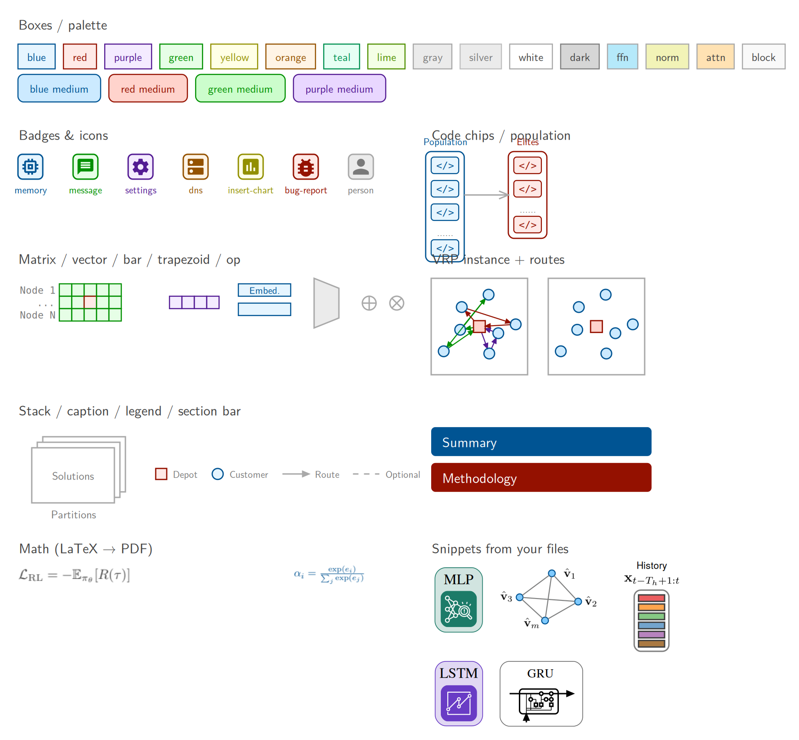

# 个人绘图风格指南（从 120 个 OmniGraffle 源文件蒸馏）

> 数据来源：`sources/OmniGraffle/` 中 2022-08 至 2026-10 的 120 个文件、433 页画布、
> 33 837 个形状、9 421 条连线、10 541 段文字。原始统计见 `style/corpus_stats.json`
> （可用 `python -m ogkit analyze sources/OmniGraffle` 随时重算）。
> 机器可读的风格令牌在 `style/themes/crayon.yaml` 与 `style/themes/soft.yaml`。

---

## 0. 一句话概括

**“白底、细线、浅色同色系”**：元素用 macOS 蜡笔色的 *亮色 + 10% 透明度* 填充，描边和文字用同色相的 *深色蜡笔色*；
容器是白底 + 彩色细边框 + 彩色标题；连线一律浅灰 `#A9A9A9`、1pt、小箭头；正文是 LM Sans 10（LaTeX 风格的无衬线体），
代码/变量用 Monaco（2026 年起 Maple Mono）；公式用 LaTeX 生成的矢量 PDF。无阴影、无渐变、无粗边框。

## 1. 颜色

### 1.1 核心机制：蜡笔色配对（crayon pair）

| 色相 | 填充（亮色 × α） | 描边 / 文字（深色） | 出现次数（≥2024） | 典型语义 |
|---|---|---|---|---|
| blue | `#0096FF` Aqua × 0.1 | `#005493` Ocean | 1 861（最多） | 编码器、主要模块、"我们的"组件 |
| red | `#FF2600` Maraschino × 0.1 | `#941100` Cayenne | 894 | 环境 Environment、错误/失败、depot、`step()` |
| purple | `#9437FF` Grape × 0.1 | `#531B93` Eggplant | 509 | 解码器、Profile/偏好、记忆 |
| green | `#00F900` Spring × 0.1 | `#008F00` Clover | 322 | 输入/实例、LLM 生成器、通过、`reset()` |
| yellow | `#FFFB00` Lemon × 0.1 | `#929000` Asparagus | 279 | 全局特征、性能/评估、规则 |
| orange | `#FF9300` Tangerine × 0.1 | `#945200` Mocha | 251 | 交叉/变异、次要强调 |
| teal | `#00FA92` Sea Foam × 0.2 | `#009051` Moss | — | 分区/簇 |

* 透明度：**0.1 为常态（4 055 次），0.2 为强调（1 503 次）**，0.5 用于灰色块。
* 文字颜色 = 同色深色（`#005493` 等）；容器标题、标签文字都遵循“和边框同色”。

### 1.2 中性色（macOS 灰阶）

| 名称 | Hex | 用法 |
|---|---|---|
| Mercury | `#EBEBEB` | 灰色模块填充（常配 Aluminum 描边），也是画布背景 |
| Silver | `#D6D6D6` | 深一级灰块 |
| Magnesium | `#C0C0C0` | 次要描边 |
| **Aluminum** | **`#A9A9A9`** | **连线默认色（35%）**、灰色模块描边、白色面板描边 |
| Steel | `#797979` | **注释文字默认色**、2026 年后的连线色 |
| Iron | `#5E5E5E` | 次级正文 |
| Tungsten | `#424242` | 主正文 |

最常见的配对其实是 **白底 + Aluminum 描边**（面板/框架，3 866 次）。

### 1.3 2026 年的 “soft” 变体

2026-09 之后（AutoResearch Copilot、Water Research LLM、ERPO、DivEval）改为 **不透明的粉彩填充 + 降饱和描边**：

| 色相 | 填充 | 描边 | 文字 |
|---|---|---|---|
| blue | `#EAF5FF` | `#8AAAC9` | `#005493` |
| purple | `#F5EBFF` | `#AA8ECA` | `#531B93` |
| green | `#EEFFEB` | `#94C78D` | `#008F00` |
| yellow | `#FFFFEC` | `#C9C88F` | `#929000` |
| orange | `#FFF4EA` | `#CAA989` | `#945200` |
| red | `#FFEBE9` | `#CD8D86` | `#941100` |

配合 Maple Mono Light 14pt、`#797979` 实心箭头、更大的圆角（8–10）。对应主题 `soft`。

### 1.4 Transformer 模块配色（固定搭配）

FFN `#B5E9FA`、Norm `#F2F3B7`、Multi-Head Attention `#FFE2B3`，均为灰描边 `#A9A9A9`、圆角 5，
外框 `#EBEBEB@25%`（RouteFinder Transformer Structure、LLM Squeeze）。主题里叫 `ffn / norm / attn / block`。

## 2. 字体

| 角色 | 字体（PostScript 名） | 占比 | 说明 |
|---|---|---|---|
| 正文/标签 | `LMSans10-Regular`（Latin Modern Sans） | **58%** | 与 LaTeX 论文正文同源，粗体用 `\b` 而不是换字重 |
| 等宽/代码/变量 | `Monaco` | 16.5% | `reset()` `step()`、张量形状、`CVRPB`、`</>`、文件名 |
| 等宽（2026） | `MapleMono-NF-CN-Light/Regular` | 新增 | soft 风格的主要标签字体，支持中文 |
| 等宽（2025） | `FiraCode-Regular/Light` | 2.9% | 代码块 |
| 数学/衬线 | `CMUSerif-Roman` + LaTeX PDF | — | 真公式一律用 LaTeX 生成的 PDF 图片（473 个） |
| 早期（2022–23） | Helvetica Neue / Times / Arial | 已淘汰 | 不再使用 |

**字号（论文尺度，画布宽 500–1100pt）**：标题 12、容器标题 10、标签 8、密集细节/等宽标签 7、极小 6。
soft 风格整体放大 ~1.6×（标签 14、标题 16 粗体）。
对齐：居中 76%，左对齐 20%。几乎不用阴影（97.7% 关闭）。

## 3. 形状与线

* **方框**：直角为主（直角 18 541 次 vs 圆角）；需要圆角时用 2–6pt（容器 6–8，soft 风格 8–10）。
* **描边宽度**：1pt（主）、0.75 / 0.8 / 0.9（模块内部、容器）、0.5（细节）；海报才用 3–4pt。
* **连线**：直线 80%、正交 13%（逐年上升，2025 年起常用，拐角圆角 5）、曲线 6%（只用于“示意性”的回流/轨迹）。
* **箭头**：`StickArrow`（开口箭头，缩放 0.75）与 `FilledArrow`（实心，缩放 0.3–0.5）几乎平分；
  42% 的线没有箭头（结构线/分隔线）。线色默认 `#A9A9A9`，表示“语义流”时用色相深色（如红色 `step()`、绿色 `reset()`）。
* **虚线**：Pattern 24（短虚线，crayon）/ Pattern 1（soft），用于可选路径、阶段框、引导线。
* **文字放置习惯**：你很少把文字直接写进方框（600 次），而是在方框上**叠一个独立的文字标签**（8 465 次）。
  `ogkit` 默认把文字放进方框里（在 OmniGraffle 里更好改），视觉结果一致。

## 4. 版式与间距

* 同级元素间距 ≈ 5–25pt（中位 15）；容器内边距 ≈ 10pt；容器标题在框外正上方居中，间隔 3pt。
* 主流程从左到右；环境/反馈回路在下方，用正交线绕回（`reset()` 绿、`step()` 红、等宽字体）。
* 层级：大容器（白底彩框）⊃ 小面板（白底灰框或浅色填充）⊃ 元素（浅色填充 + 深色描边）。
* 重复结构用 “`...` / `⋯` / `......`” 省略号表达（Node 1 … Node N、Vehicle 1 … Vehicle M），省略号用灰色。
* 图例放底部一行，用小方块/圆点 + 灰色文字。

## 5. 视觉词汇（可复用母题）

| 母题 | 代表文件 | `ogkit` 接口 |
|---|---|---|
| 编码器 → 解码器 → 环境 闭环 | RL4CO / CAMP / RouteFinder / USPR / PARCO / HADES | `container` + `arrow(route="ortho")` |
| 9×9pt 特征格子矩阵（Node × Feature） | CAMP、RouteFinder、PARCO、RRNCO | `d.matrix()` / `d.vector()` |
| 细长嵌入条（“Node Embed.”） | HADES、RouteFinder | `d.bar()` |
| 梯形编码层 | RouteFinder、PARCO、HADES | `d.trapezoid()` |
| VRP 实例：方框 + depot 方块 + 客户圆点 + 路线 | DivRoute、PARCO、ScalCO、FeedbackCO、Omelet Docs | `d.vrp_instance()` |
| `</>` 代码块与种群列 | ReEvo、BuildEvo、VRPAgent、Water Research LLM | `d.code_chip()` / `d.population()` |
| 圆角方框里的 Material 图标（LLM=memory 芯片） | EvoNav、PILLM、VRPAgent、JudgeFlow | `d.badge("memory")` / `d.icon()` |
| 性能仪表盘 | BuildEvo、ReEvo、VRPAgent | `d.gauge()` |
| 叠放卡片（Partitions / Solutions） | DivRoute、FeedbackCO | `d.stack()` |
| ⊕ 残差相加 | RouteFinder Transformer、LLM Squeeze | `d.op("+")` |
| 对比型 Motivation（左：传统 ✗，右：Ours ✓） | AAAI CrowdSPH、EvoNav/TrajEvo Motivation | 两个 `container` + `badge("cancel"/"check-circle")` |
| 海报节标题条 | AoP-SAM、RL4CO、Graph Spline Nets Poster | `d.section_bar()` |
| 模型 App 图标瓦片（MLP/LSTM/GRU） | Water Research 系列 | `d.snippet("tile-mlp")` |

## 6. 风格演进

| 年份 | 文件数 | 主字体 | 特征 |
|---|---|---|---|
| 2022 | 2 | Helvetica Neue, Times | 黑色描边、白底，学生期风格 |
| 2023 | 26 | LM Sans, Times, Arial, Courier | 开始使用 LM Sans；粗边框、蓝/橙色块，较“厚重” |
| 2024 | 25 | LM Sans, Monaco, Menlo | **蜡笔配对体系成型**；海报粗线 3–4pt |
| 2025 | 43 | LM Sans, Monaco, Fira Code, CMU | 最高产；细线 0.75–1、正交线普及、图标徽章、`</>` 种群 |
| 2026 | 24 | LM Sans, Monaco, Maple Mono | 引入 Maple Mono、soft 粉彩变体、更圆的框 |

## 7. 做 / 不做

**做**：白底；浅色填充 + 同色深描边；彩色容器标题；灰色细连线；等宽字体写代码和变量；公式用 LaTeX；
用省略号表示重复；同类元素尺寸一致、严格对齐；颜色有语义且全图一致（同一概念始终同一色相）。

**不做**：阴影、渐变（仅 56 处）、纯黑粗边框、饱和色大面积填充、多于 4–5 个色相、斜线乱连（优先水平/垂直/正交）、
在框里塞长句（长说明放框外的灰色注释）。
