# Asset library catalog

Auto-generated by `python -m ogkit.library build sources/OmniGraffle` — do not edit by hand.

* **39 vector icons** (OmniGraffle custom shapes, recolourable) — `d.icon(name, x, y, size, color=...)`
* **59 reusable images** — `d.image('library/images/<file>', ...)`  (corpus totals by category: {'logo': 70, 'math': 473, 'figure': 140, 'photo': 42, 'plot': 126, 'icon': 23})
* **34 snippets** (components = groups reused or named in your files) — `d.snippet(name, x, y)`
* **120 source figures** in `gallery/` — references to imitate

Search from the shell: `python -m ogkit.library search <words>`

## Icons

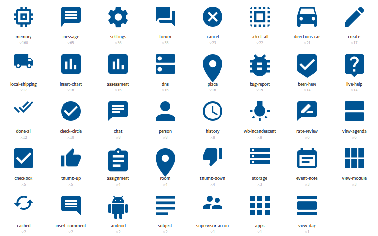

| name | uses | aspect | example files |
|---|---|---|---|
| `cancel` | 23 | 1.0 | AAAI CrowdSPH, EvoNav Overview, JudgeFlow Overview |
| `checkbox` | 5 | 1.0 | AAAI CrowdSPH, TrajEvo Overview |
| `cached` | 2 | 0.727 | AoP SAM Overview |
| `directions-car` | 21 | 1.0 | CAMP Examples, Shipload Overview |
| `memory` | 160 | 1.0 | DivEval, EvoNav Overview, JudgeFlow Overview |
| `assignment` | 4 | 1.156 | DivEval |
| `insert-comment` | 2 | 1.0 | DivEval |
| `insert-chart` | 16 | 1.0 | DivEval, PILLM Overview |
| `chat` | 8 | 1.0 | EvoNav Motivation, TrajEvo Motivation |
| `person` | 8 | 1.0 | EvoNav Motivation, TrajEvo Motivation |
| `settings` | 36 | 1.028 | EvoNav Motivation, EvoNav Overview, JudgeFlow Overview |
| `assessment` | 16 | 1.0 | EvoNav Overview, TrajEvo Overview |
| `check-circle` | 10 | 1.0 | EvoNav Overview, Shipload Overview |
| `select-all` | 22 | 1.0 | EvoNav Overview, TrajEvo Motivation |
| `forum` | 35 | 1.0 | EvoNav Overview, JudgeFlow Overview, TrajEvo Overview |
| `android` | 2 | 1.2 | EvoNav Overview |
| `subject` | 2 | 1.0 | EvoNav Overview |
| `room` | 4 | 1.429 | EvoNav Overview |
| `thumb-up` | 5 | 0.909 | FeedbackCO Overview |
| `thumb-down` | 4 | 0.909 | FeedbackCO Overview |
| `supervisor-account` | 1 | 0.7 | FeedbackCO Overview |
| `message` | 65 | 1.0 | JudgeFlow Overview, PILLM Overview |
| `create` | 17 | 1.0 | JudgeFlow Overview |
| `been-here` | 14 | 1.203 | JudgeFlow Overview |
| `live-help` | 14 | 1.167 | JudgeFlow Overview |
| `bug-report` | 15 | 1.125 | JudgeFlow Overview |
| `apps` | 1 | 1.0 | Multi-agent RouteFinder |
| `local-shipping` | 17 | 0.727 | Multi-agent RouteFinder |
| `dns` | 16 | 1.0 | PILLM Overview |
| `rate-review` | 6 | 1.0 | PILLM Overview |
| `storage` | 3 | 0.8 | RL4CO Overall |
| `event-note` | 3 | 1.0 | Shipload Overview |
| `view-module` | 3 | 1.0 | Shipload Overview |
| `view-day` | 1 | 1.0 | Shipload Overview |
| `place` | 16 | 1.429 | Shipload Overview |
| `view-agenda` | 6 | 1.0 | TrajEvo Motivation |
| `history` | 8 | 1.0 | TrajEvo Motivation |
| `done-all` | 12 | 0.577 | TrajEvo Motivation |
| `wb-incandescent` | 8 | 1.0 | TrajEvo Motivation |

## Images

### avatar

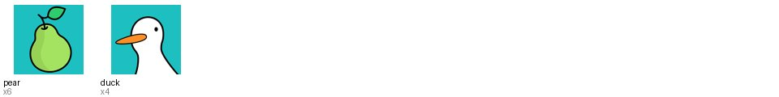

| key | file | uses | display size (pt) |
|---|---|---|---|
| `avatar/pear` | `images/avatar/pear.png` | 6 | 90.0×90.0 |
| `avatar/duck` | `images/avatar/duck.png` | 4 | 90.0×90.0 |

### icon

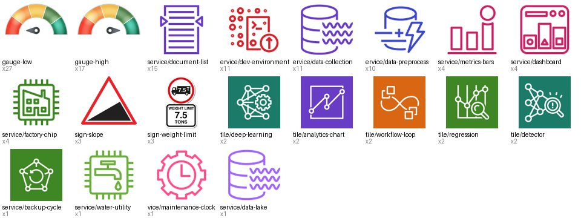

| key | file | uses | display size (pt) |
|---|---|---|---|
| `icon/service/document-list` | `images/icon/service/document-list.pdf` | 15 | 45.8×45.8 |
| `icon/service/dev-environment` | `images/icon/service/dev-environment.pdf` | 11 | 50.0×50.0 |
| `icon/service/data-collection` | `images/icon/service/data-collection.pdf` | 11 | 50.0×50.0 |
| `icon/service/metrics-bars` | `images/icon/service/metrics-bars.pdf` | 4 | 25.0×25.0 |
| `icon/service/dashboard` | `images/icon/service/dashboard.pdf` | 4 | 25.0×25.0 |
| `icon/service/factory-chip` | `images/icon/service/factory-chip.pdf` | 4 | 30.0×30.0 |
| `icon/gauge-high` | `images/icon/gauge-high.png` | 17 | 15.0×7.5 |
| `icon/gauge-low` | `images/icon/gauge-low.png` | 27 | 15.0×7.5 |
| `icon/sign-slope` | `images/icon/sign-slope.png` | 3 | 33.1×31.1 |
| `icon/sign-weight-limit` | `images/icon/sign-weight-limit.png` | 3 | 33.4×54.6 |
| `icon/service/data-preprocess` | `images/icon/service/data-preprocess.pdf` | 10 | 50.1×50.1 |
| `icon/service/backup-cycle` | `images/icon/service/backup-cycle.pdf` | 1 | 30.0×30.0 |
| `icon/service/water-utility` | `images/icon/service/water-utility.pdf` | 1 | 35.0×35.0 |
| `icon/service/maintenance-clock` | `images/icon/service/maintenance-clock.pdf` | 1 | 35.0×35.0 |
| `icon/service/data-lake` | `images/icon/service/data-lake.pdf` | 1 | 35.0×35.0 |
| `icon/tile/deep-learning` | `images/icon/tile/deep-learning.pdf` | 2 | 50.0×50.0 |
| `icon/tile/analytics-chart` | `images/icon/tile/analytics-chart.pdf` | 2 | 50.0×50.0 |
| `icon/tile/workflow-loop` | `images/icon/tile/workflow-loop.pdf` | 2 | 50.0×50.0 |
| `icon/tile/regression` | `images/icon/tile/regression.pdf` | 2 | 50.0×50.0 |
| `icon/tile/detector` | `images/icon/tile/detector.pdf` | 2 | 50.0×50.0 |

### logo

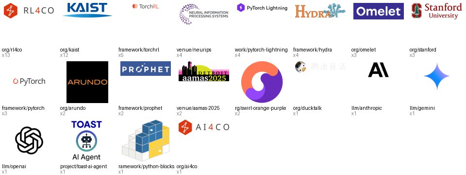

| key | file | uses | display size (pt) |
|---|---|---|---|
| `logo/org/rl4co` | `images/logo/org/rl4co.pdf` | 13 | 132.8×112.9 |
| `logo/venue/neurips` | `images/logo/venue/neurips.pdf` | 4 | 502.3×225.9 |
| `logo/org/kaist` | `images/logo/org/kaist.png` | 12 | 414.9×118.5 |
| `logo/org/arundo` | `images/logo/org/arundo.png` | 2 | 105.1×26.1 |
| `logo/framework/prophet` | `images/logo/framework/prophet.png` | 2 | 106.0×30.3 |
| `logo/org/omelet` | `images/logo/org/omelet.png` | 3 | 100.1×32.4 |
| `logo/venue/aamas-2025` | `images/logo/venue/aamas-2025.png` | 2 | 134.1×53.6 |
| `logo/org/ducktalk` | `images/logo/org/ducktalk.png` | 1 | 138.0×30.0 |
| `logo/org/swirl-orange-purple` | `images/logo/org/swirl-orange-purple.png` | 2 | 111.1×111.1 |
| `logo/org/stanford` | `images/logo/org/stanford.png` | 3 | 420.0×184.1 |
| `logo/llm/anthropic` | `images/logo/llm/anthropic.png` | 1 | 19.0×19.0 |
| `logo/llm/gemini` | `images/logo/llm/gemini.png` | 1 | 16.9×20.8 |
| `logo/llm/openai` | `images/logo/llm/openai.png` | 1 | 16.9×16.9 |
| `logo/project/toast-ai-agent` | `images/logo/project/toast-ai-agent.png` | 1 | 99.1×123.0 |
| `logo/framework/torchrl` | `images/logo/framework/torchrl.png` | 5 | 55.5×10.9 |
| `logo/framework/pytorch` | `images/logo/framework/pytorch.png` | 3 | 63.8×16.8 |
| `logo/framework/pytorch-lightning` | `images/logo/framework/pytorch-lightning.png` | 4 | 111.7×20.2 |
| `logo/framework/hydra` | `images/logo/framework/hydra.png` | 4 | 55.5×15.9 |
| `logo/framework/python-blocks` | `images/logo/framework/python-blocks.png` | 1 | 38.6×34.0 |
| `logo/org/ai4co` | `images/logo/org/ai4co.png` | 1 | 114.2×34.7 |

### photo

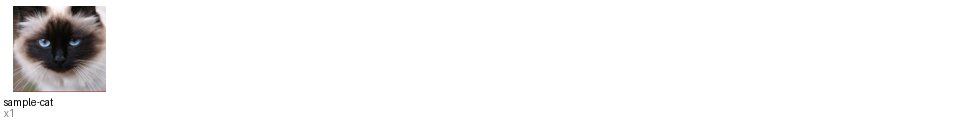

| key | file | uses | display size (pt) |
|---|---|---|---|
| `photo/sample-cat` | `images/photo/sample-cat.tiff` | 1 | 91.1×91.1 |

### texture

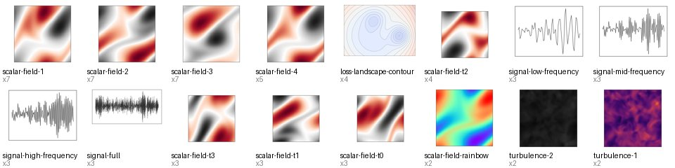

| key | file | uses | display size (pt) |
|---|---|---|---|
| `texture/signal-low-frequency` | `images/texture/signal-low-frequency.pdf` | 3 | 252.4×51.6 |
| `texture/signal-mid-frequency` | `images/texture/signal-mid-frequency.pdf` | 3 | 252.4×51.6 |
| `texture/signal-high-frequency` | `images/texture/signal-high-frequency.pdf` | 3 | 252.4×51.6 |
| `texture/signal-full` | `images/texture/signal-full.pdf` | 3 | 706.8×60.2 |
| `texture/loss-landscape-contour` | `images/texture/loss-landscape-contour.pdf` | 4 | 165.7×119.7 |
| `texture/scalar-field-1` | `images/texture/scalar-field-1.pdf` | 7 | 34.0×34.0 |
| `texture/scalar-field-2` | `images/texture/scalar-field-2.pdf` | 7 | 34.0×34.0 |
| `texture/scalar-field-3` | `images/texture/scalar-field-3.pdf` | 7 | 34.0×34.0 |
| `texture/scalar-field-rainbow` | `images/texture/scalar-field-rainbow.pdf` | 2 | 45.4×45.0 |
| `texture/turbulence-2` | `images/texture/turbulence-2.pdf` | 2 | 130.0×130.0 |
| `texture/turbulence-1` | `images/texture/turbulence-1.pdf` | 2 | 130.0×130.0 |
| `texture/scalar-field-4` | `images/texture/scalar-field-4.pdf` | 5 | 34.0×34.0 |
| `texture/scalar-field-t3` | `images/texture/scalar-field-t3.pdf` | 3 | 62.0×62.0 |
| `texture/scalar-field-t2` | `images/texture/scalar-field-t2.pdf` | 4 | 62.0×62.0 |
| `texture/scalar-field-t1` | `images/texture/scalar-field-t1.pdf` | 3 | 62.0×62.0 |
| `texture/scalar-field-t0` | `images/texture/scalar-field-t0.pdf` | 3 | 62.0×62.0 |

## Snippets

| preview | name | size (pt) | texts | used in |
|---|---|---|---|---|
|  | `op-times-box` | 15×15 |  | 2 file(s) ×6 |
| 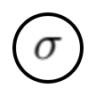 | `op-sigma-circle` | 19×19 |  | 2 file(s) ×4 |
| 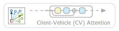 | `attention-row-client-vehicle` | 132×30 | Client-Vehicle (CV) Attention | 2 file(s) ×3 |
| 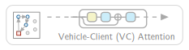 | `attention-row-vehicle-client` | 132×30 | Vehicle-Client (VC) Attention | 2 file(s) ×3 |
| 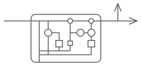 | `gru-cell-schematic` | 149×66 |  | 2 file(s) ×3 |
| 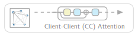 | `attention-row-client-client` | 132×30 | Client-Client (CC) Attention | 2 file(s) ×3 |
| 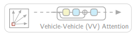 | `attention-row-vehicle-vehicle` | 132×30 | Vehicle-Vehicle (VV) Attention | 2 file(s) ×3 |
| 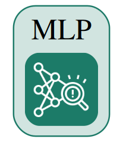 | `tile-mlp` | 76×89 | MLP | 2 file(s) ×2 |
| 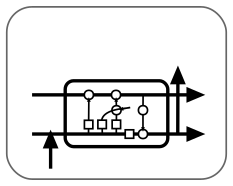 | `card-lstm-cell` | 130×102 |  | 2 file(s) ×2 |
| 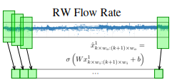 | `conv1d-over-timeseries` | 233×109 | …; …; RW Flow Rate | 2 file(s) ×2 |
| 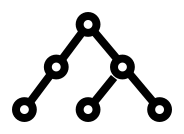 | `binary-tree-right` | 38×26 |  | 2 file(s) ×2 |
| 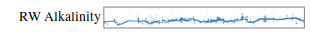 | `timeseries-strip` | 303×26 | RW Alkalinity | 2 file(s) ×2 |
|  | `graph-k5-mini` | 16×15 |  | 2 file(s) ×2 |
| 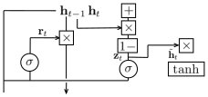 | `gru-cell-equations` | 215×97 |  | 2 file(s) ×2 |
| 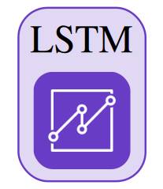 | `tile-lstm` | 76×89 | LSTM | 2 file(s) ×2 |
| 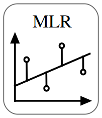 | `card-linear-regression` | 103×120 | MLR | 2 file(s) ×2 |
| 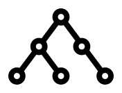 | `binary-tree-left` | 36×26 |  | 2 file(s) ×2 |
| 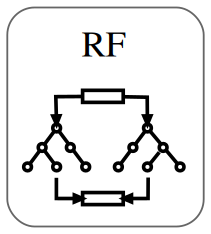 | `card-random-forest` | 108×120 | RF | 2 file(s) ×2 |
| 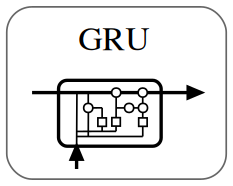 | `card-gru-cell` | 130×102 | GRU | 2 file(s) ×2 |
| 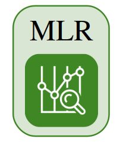 | `tile-mlr` | 76×89 | MLR | 2 file(s) ×2 |
| 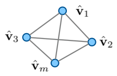 | `graph-k4-blue` | 94×59 |  | 2 file(s) ×2 |
| 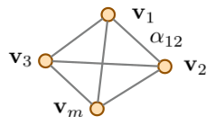 | `graph-k4-orange-weighted` | 99×55 |  | 2 file(s) ×2 |
| 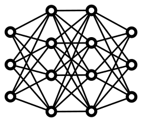 | `mlp-dense-network` | 85×72 |  | 2 file(s) ×2 |
|  | `op-plus-box` | 15×15 |  | 2 file(s) ×2 |
| 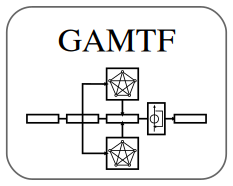 | `card-gamtf` | 130×102 | GAMTF | 2 file(s) ×2 |
|  | `tile-gamtf` | 84×89 | GAMTF | 2 file(s) ×2 |
| 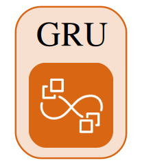 | `tile-gru` | 76×89 | GRU | 2 file(s) ×2 |
|  | `legend-depot-customers` | 87×24 | >; > | 1 file(s) ×6 |
| 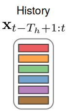 | `token-stack-history` | 127×215 | History | 1 file(s) ×2 |
| 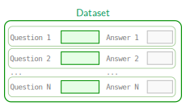 | `qa-dataset-table` | 168×94 | ...; Answer N; Answer 2; Answer 1 | 1 file(s) ×2 |
| 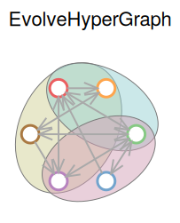 | `hypergraph-blobs` | 196×243 | EvolveHyperGraph | 1 file(s) ×2 |
| 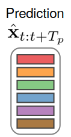 | `token-stack-prediction` | 108×215 | Prediction | 1 file(s) ×2 |
| 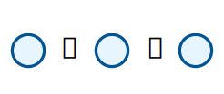 | `legend-customers-arrows` | 67×24 | >; > | 1 file(s) ×2 |
| 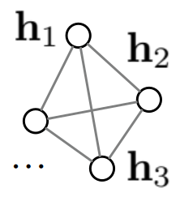 | `graph-k4-h-nodes` | 68×75 | … | 1 file(s) ×1 |

## Gallery (source figures)

| preview | figure | kind | modified | fonts |
|---|---|---|---|---|
| 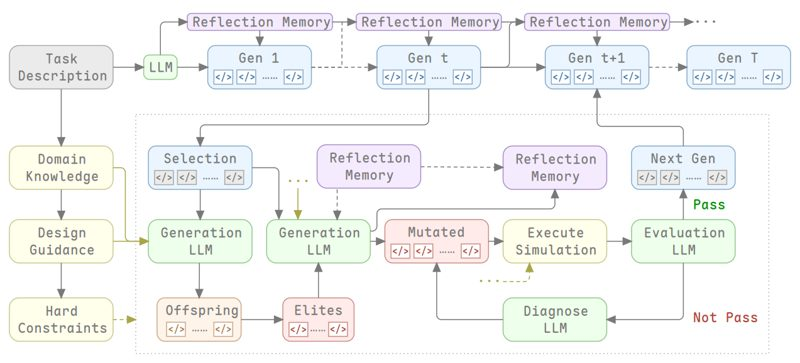 | Water Research LLM | illustration | 2026-10-15 | MapleMono-NF-CN-Regular, MapleMono-NF-CN-Medium, MapleMono-NF-CN-Light |
| 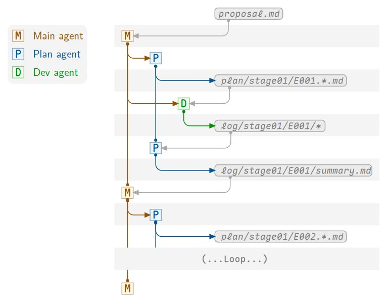 | AutoResearch Copilot | overview/architecture | 2026-10-01 | MapleMono-NF-CN-LightItalic, LMSans10-Regular, MapleMono-NF-CN-Light |
| 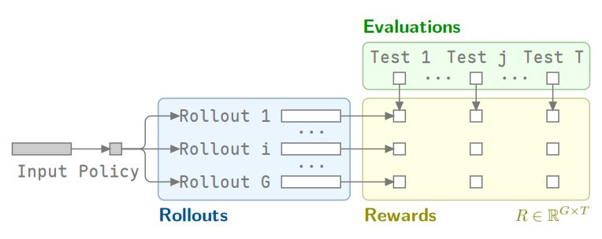 | ERPO | illustration | 2026-09-29 | MapleMono-NF-CN-Light, LMSans10-Regular |
| 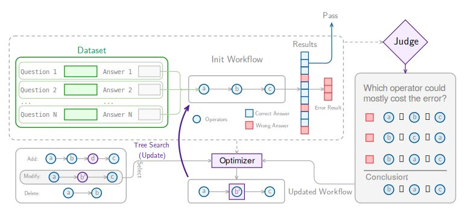 | JudgeFlow Overview | overview/architecture | 2026-08-25 | LMSans10-Regular, HelveticaNeue, Monaco |
| 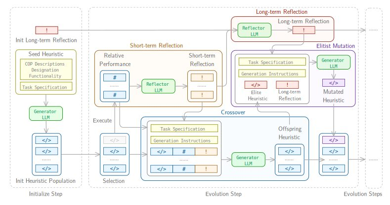 | ReEvo Overview | overview/architecture | 2026-08-25 | LMSans10-Regular, Monaco |
| 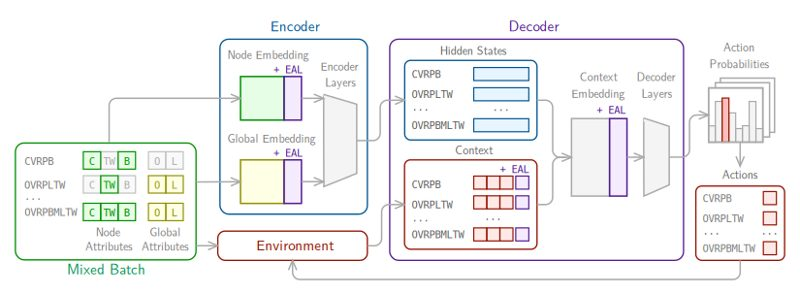 | RouteFinder Overview | overview/architecture | 2026-08-25 | LMSans10-Regular, Monaco |
| 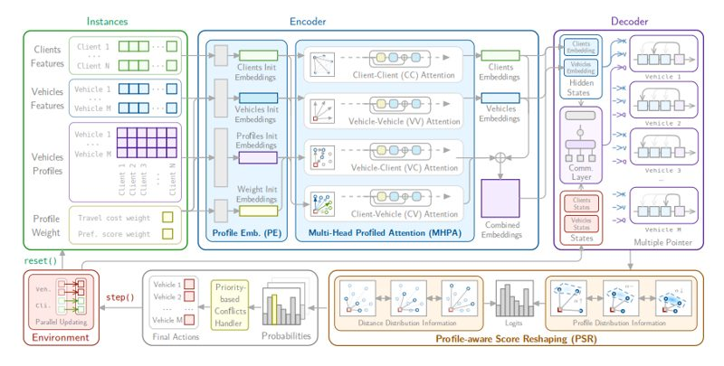 | USPR Overview | overview/architecture | 2026-08-25 | LMSans10-Regular, Monaco, Avenir-Book |
| 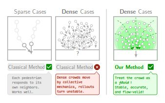 | AAAI CrowdSPH | illustration | 2026-07-29 | MapleMono-NF-CN-Light, LMSans10-Regular, MapleMono-NF-CN-BoldItalic |
| 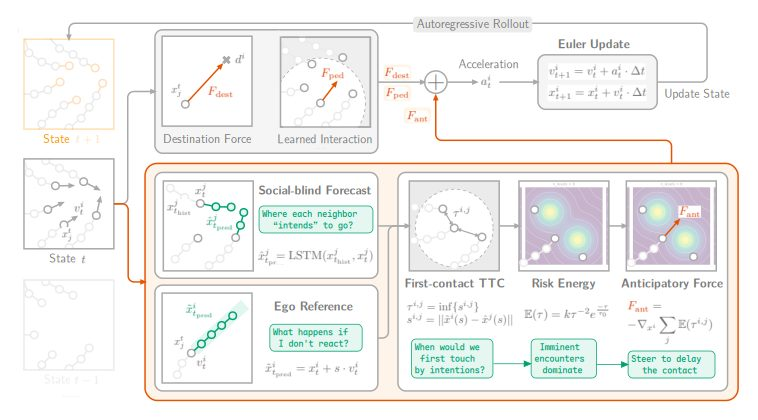 | AAAI Forecast Crowd Simulation | illustration | 2026-07-29 | LMSans10-Regular, MapleMono-NF-CN-Light |
| 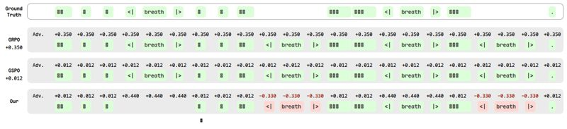 | Step Audio Post Training | illustration | 2026-06-22 | MapleMono-NF-CN-Regular, MapleMono-NF-CN-Bold |
| 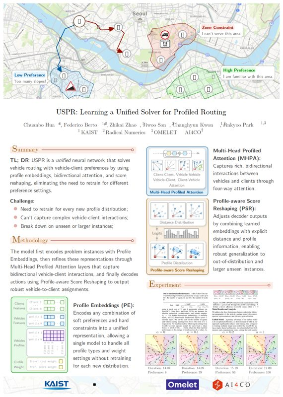 | USPR Poster | poster | 2026-06-02 | LMSans10-Regular, CMUSerif-Roman, AppleColorEmoji |
| 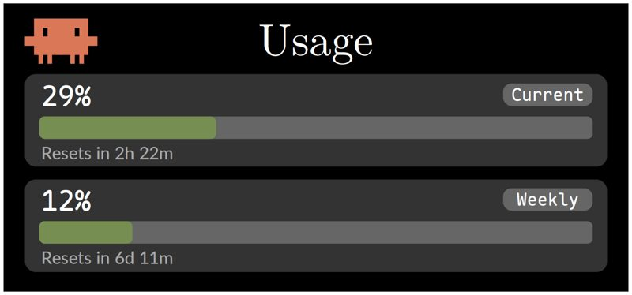 | Claude Usage Demo | ui/cheatsheet | 2026-05-17 | Avenir-Book, MapleMono-NF-CN-Light, CMUSerif-Roman |
| 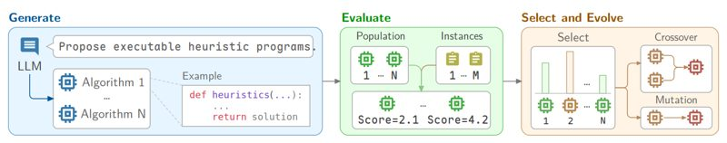 | DivEval | illustration | 2026-05-07 | LMSans10-Regular, MapleMono-NF-CN-Light, Menlo-Regular |
| 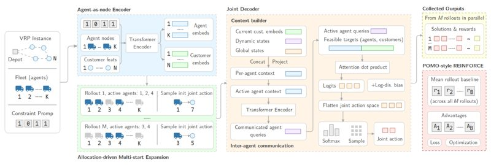 | Multi-agent RouteFinder | overview/architecture | 2026-05-07 | LMSans10-Regular, MapleMono-NF-CN-Thin |
| 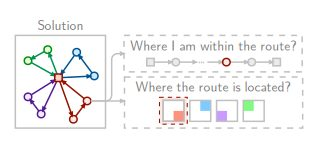 | HADES Illustration | illustration | 2026-05-06 | LMSans10-Regular, Monaco |
|  | Trace Studio Logo | logo/cover | 2026-04-14 |  |
|  | Agent workflow cheatsheet | ui/cheatsheet | 2026-04-07 | LMSans10-Regular, MapleMono-NF-CN-Regular |
|  | Sell Items | illustration | 2026-03-17 | MapleMono-NF-CN-Regular |
|  | CAMP AAMAS 2025 Poster | poster | 2026-01-14 | LMSans10-Regular, LucidaGrande, AppleColorEmoji |
|  | CAMP Examples | illustration | 2026-01-14 | Monaco, LMSans10-Regular |
|  | Gradient Evolve Motivation | motivation/comparison | 2026-01-14 | MapleMono-NF-CN-Light |
|  | HiTree | illustration | 2026-01-14 | CMUSerif-Roman |
|  | EvolveGradient | illustration | 2026-01-13 | CMUSerif-Roman |
|  | Ducktalk | illustration | 2026-01-05 |  |
|  | CAMP Visualization Paper | plot/visualization | 2025-12-20 | CMUSerif-Roman |
|  | Camel Up UI | ui/cheatsheet | 2025-12-14 | Monaco |
|  | Splendar UI | ui/cheatsheet | 2025-12-14 | Monaco |
|  | Water Research 5 Cynobactera | plot/visualization | 2025-12-04 | CMUSerif-Roman |
|  | AoP-SAM Poster AAAI | poster | 2025-12-03 | LMSans10-Regular, Calibri-Bold, CourierNewPSMT |
|  | AoP-SAM Poster NeurIPS | poster | 2025-12-03 | LMSans10-Regular, Calibri-Bold, Calibri |
|  | RRNCO Illustration | illustration | 2025-12-03 | LMSans10-Regular, Monaco, Avenir-Book |
|  | HADES Statistic | plot/visualization | 2025-11-21 |  |
|  | Our Book Cover | logo/cover | 2025-10-10 | SourceHanSerifSC-Regular, SourceHanSerifSC-Light |
|  | EvoNav Overview | overview/architecture | 2025-10-09 | LMSans10-Regular, FiraCode-Regular |
|  | EvoNav Motivation | motivation/comparison | 2025-10-07 | FiraCode-Regular, LMSans10-Regular, CMUSerif-Roman |
|  | McDonals Overview | overview/architecture | 2025-10-07 |  |
|  | TrajEvo Motivation | motivation/comparison | 2025-10-06 | LMSans10-Regular |
|  | HADES Overview | overview/architecture | 2025-09-25 | FiraCode-Light, LMSans10-Regular, FiraCode-Regular |
|  | VRPAgent Overview | overview/architecture | 2025-09-23 | LMSans10-Regular, Monaco, AppleColorEmoji |
|  | PILLM Overview | overview/architecture | 2025-09-22 | LMSans10-Regular, Monaco, Avenir-Book |
|  | TrajEvo Overview | overview/architecture | 2025-07-24 | FiraCode-Light, CMUSerif-Roman |
|  | TrajEvo CGES | illustration | 2025-07-22 | CMUSerif-Roman |
|  | FeedbackCO Illustration | illustration | 2025-06-23 | Monaco, LMSans10-Regular |
|  | AI4CO Workshop Speakers | illustration | 2025-06-05 |  |
|  | BuildEvo Overview | overview/architecture | 2025-06-01 | Avenir-Book, Monaco, LMSans10-Regular |
|  | AI4CO Homepage News Icon | logo/cover | 2025-05-30 | AvenirNext-Medium |
|  | AoP SAM Overview | overview/architecture | 2025-05-17 | LMSans10-Regular |
|  | Travel Map | illustration | 2025-05-14 |  |
|  | PARCO Illustration | illustration | 2025-05-13 | LMSans10-Regular |
|  | RL4CO Policy 2024 NeurIPS | overview/architecture | 2025-05-12 | Avenir-Book, Monaco, LMSans10-Regular |
|  | CAMP Illustration | illustration | 2025-05-07 | LMSans10-Regular, Monaco, Avenir-Book |
|  | CAMP Pareto | plot/visualization | 2025-04-28 |  |
|  | FeedbackCO Overview | overview/architecture | 2025-04-21 | LMSans10-Regular, Monaco |
|  | Shipload Overview | overview/architecture | 2025-04-20 | LMSans10-Regular, Monaco, AppleColorEmoji |
|  | Application of AI Model | overview/architecture | 2025-04-18 | LMSans10-Regular, Monaco |
|  | Chiplet Placement | illustration | 2025-04-18 | LMSans10-Regular, Monaco |
|  | DivRoute | illustration | 2025-04-18 | LMSans10-Regular, Monaco |
|  | Graph Spline Nets Overview | overview/architecture | 2025-04-18 | TimesNewRomanPSMT, TimesNewRomanPS-ItalicMT |
|  | PARCO Overall | overview/architecture | 2025-04-18 | LMSans10-Regular, Monaco, Avenir-Book |
|  | RL4CO Policy | overview/architecture | 2025-04-18 | LMSans10-Regular, AmericanTypewriter, Avenir-Book |
|  | Robot Navigation Overview Illustration | overview/architecture | 2025-04-18 | ArialMT |
|  | Transformer Time-series Prediction Model | overview/architecture | 2025-04-18 | LMSans10-Regular, Monaco, Avenir-Book |
|  | Transformer Time-series Prediction Overall | overview/architecture | 2025-04-18 | LMSans10-Regular, Monaco, PingFangSC-Regular |
|  | Omelet AI Agent | overview/architecture | 2025-04-08 | FiraCode-Regular, LMSans10-Regular, AppleColorEmoji |
|  | Water Research New Ideas | motivation/comparison | 2025-04-04 | CMUSerif-Roman |
|  | Water Research Paper 4 Baselines | plot/visualization | 2025-03-10 | CMUSerif-Roman |
|  | RL4CO Plot Book | plot/visualization | 2025-02-24 | CMUSerif-Roman |
|  | OMELET AI Agents Compare | motivation/comparison | 2024-12-26 | HelveticaNeue |
|  | CAMP Visualization | plot/visualization | 2024-12-20 | LMSans10-Regular |
|  | Drift Gege Illustration | illustration | 2024-12-04 | SourceHanSerifSC-Regular |
|  | Omelet AI Agent Process | overview/architecture | 2024-12-03 | LMSans10-Regular, Monaco |
|  | RouteFinder Proble Describtion | illustration | 2024-11-24 | LMSans10-Regular, Monaco |
|  | AI4CO Blueprint | overview/architecture | 2024-11-11 | Monaco, Helvetica |
|  | LLM Squeeze | illustration | 2024-10-30 | LMSans10-Regular |
|  | CAMP Results Example | plot/visualization | 2024-10-11 | LMSans10-Regular, Monaco |
|  | Application of AI Overview | overview/architecture | 2024-10-08 | LMSans10-Regular, Monaco, PingFangSC-Regular |
|  | RouteFinder Transformer Structure | overview/architecture | 2024-09-30 | LMSans10-Regular |
|  | RouteFinder Overview Omelet | overview/architecture | 2024-09-23 | LMSans10-Regular, Monaco, Avenir-Book |
|  | Robot Navigation Visualization 2 | plot/visualization | 2024-07-31 |  |
|  | Robot Navigation Visualization 3 | plot/visualization | 2024-07-30 | HelveticaNeue |
|  | Robot Navigation Visualization | plot/visualization | 2024-07-30 | ArialMT |
|  | Omeleet Docs | illustration | 2024-07-15 | LMSans10-Regular, Monaco |
|  | RL4CO UML | overview/architecture | 2024-06-10 | Monaco |
|  | RL4CO Overall | overview/architecture | 2024-06-05 | LMSans10-Regular |
|  | RouteFinder Sampling | illustration | 2024-05-22 | LMSans10-Regular, Monaco |
|  | ReEvo Reflect Example | illustration | 2024-05-15 | Menlo-Regular, LMSans10-Regular |
|  | PyVRP & RL4CO | illustration | 2024-04-24 | Monaco |
|  | PolyNet GLOP Illustration | illustration | 2024-04-02 | LMSans10-Regular, Monaco |
|  | SSM Illustration | illustration | 2024-03-27 |  |
|  | Application of AI Normalization | illustration | 2024-03-04 | LMSans10-Regular, Monaco |
|  | Chemosphere Overview | overview/architecture | 2024-02-29 | LMSans10-Regular, Monaco |
|  | Anomaly Detection Overview | overview/architecture | 2024-02-08 | TimesNewRomanPSMT, TimesNewRomanPS-BoldMT, HelveticaNeue |
|  | Robot Navigation Experiment Visualization | plot/visualization | 2023-12-27 | ArialMT |
|  | EvolveHyperGraph Main Illustration | illustration | 2023-12-26 | ArialMT |
|  | Robot Navigation Group Reward Illustration | illustration | 2023-12-26 | LMSans10-Regular |
|  | Robot Navigation Hero Experiment | plot/visualization | 2023-12-26 | ArialMT |
|  | Robot Navigation Hero Illustration | illustration | 2023-12-17 | ArialMT |
|  | Graph Spline Nets Poster | poster | 2023-12-05 | LMSans10-Regular, CourierNewPSMT, Calibri |
|  | OpenPDP Illustration | illustration | 2023-11-17 | LMSans10-Regular |
|  | Foundation Model | overview/architecture | 2023-11-09 | FiraCode-Regular, LMSans10-Regular |
|  | ScalCO Illustration | illustration | 2023-10-31 | LMSans10-Regular, STSongti-SC-Regular |
|  | RL4CO Poster | poster | 2023-10-23 | LMSans10-Regular, CourierNewPSMT, CourierNewPS-ItalicMT |
|  | GAMTF Overview | overview/architecture | 2023-10-15 | TimesNewRomanPSMT |
|  | Graph OOD Overview | overview/architecture | 2023-10-15 | LMSans10-Regular, TimesNewRomanPS-ItalicMT, STSongti-SC-Regular |
|  | Graph Spline Nets Collocation Illustration | illustration | 2023-10-15 | TimesNewRomanPS-ItalicMT |
|  | Graph Spline Nets MPNN Overview | overview/architecture | 2023-10-15 | TimesNewRomanPSMT |
|  | Graph Spline Nets NV Illustration | illustration | 2023-10-15 | Avenir-Book |
|  | Hidden Interpolation Overview | overview/architecture | 2023-10-15 | TimesNewRomanPSMT |
|  | RL4Phy Illustration | illustration | 2023-10-15 | Avenir-BookOblique |
|  | Water Research Overview | overview/architecture | 2023-10-15 | TimesNewRomanPSMT |
|  | CrowdNav Dataset Visualization | plot/visualization | 2023-09-03 |  |
|  | GraphSplineNetsRebuttal | motivation/comparison | 2023-08-10 | Avenir-Book |
|  | SplineGraphNets | illustration | 2023-08-08 | TimesNewRomanPSMT, TimesNewRomanPS-ItalicMT |
|  | Multi-agent RL for Physical Control Illustration | overview/architecture | 2023-07-23 | Avenir-BookOblique |
|  | EvolveHyperGraph2 | illustration | 2023-07-09 |  |
|  | RL4Warning | illustration | 2023-06-19 | HelveticaNeue, HelveticaNeue-BoldItalic |
|  | WaterResearch | illustration | 2023-05-13 | TimesNewRomanPSMT |
|  | Anomaly Detection | illustration | 2023-02-18 | TimesNewRomanPSMT, TimesNewRomanPS-BoldMT, HelveticaNeue |
|  | RelationalInference | illustration | 2022-11-09 | HelveticaNeue |
|  | Hidden Interpolation | illustration | 2022-11-05 | TimesNewRomanPSMT |
